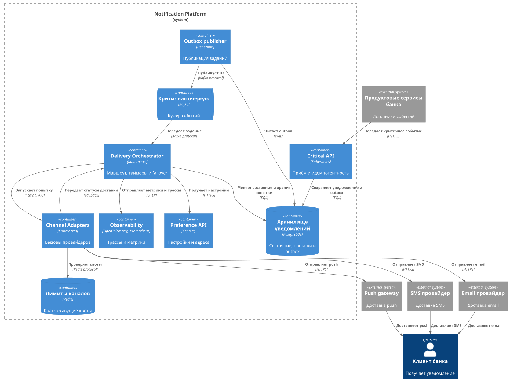
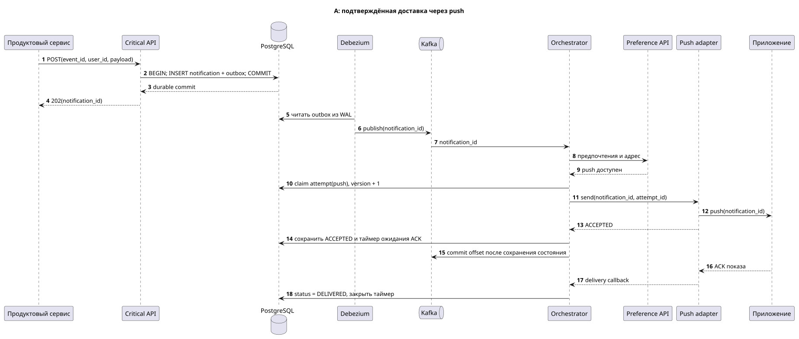
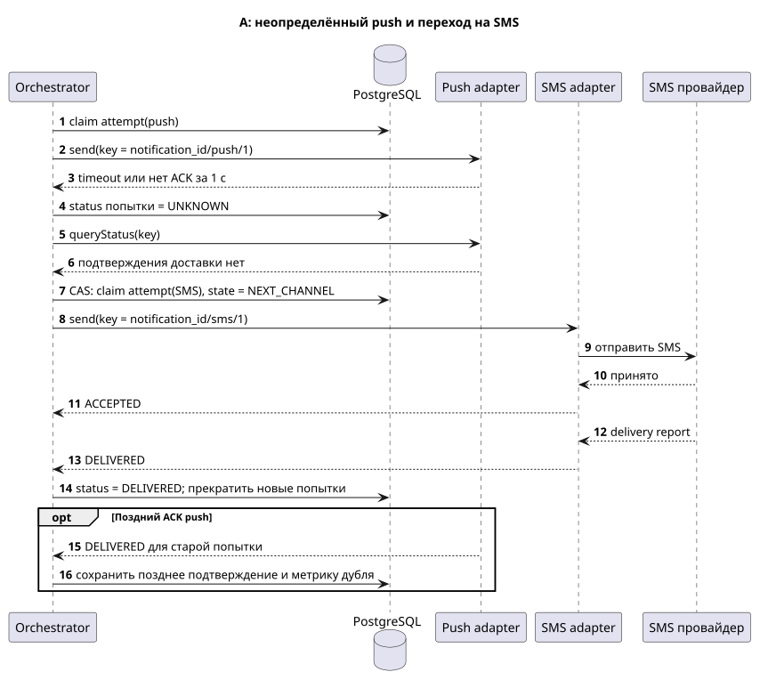
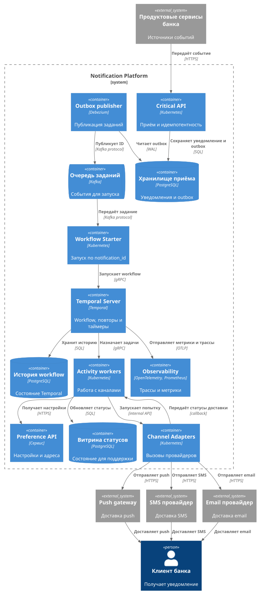
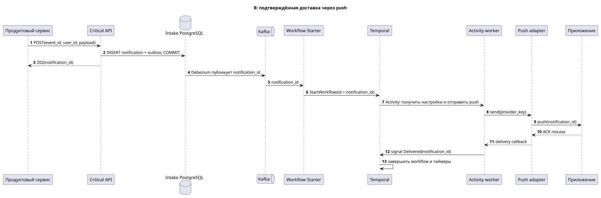
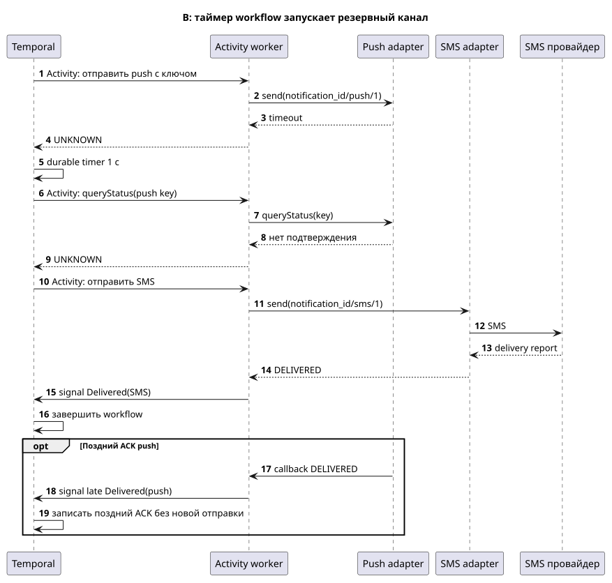

# RFC: доставка транзакционных уведомлений с переключением каналов

| Поле | Значение |
| --- | --- |
| Статус | DESIGN |
| Автор | Timofei Avetisov |
| Дата | 2026-11-17 |

## Оглавление

1. [Контекст](#контекст)
2. [Продуктовый анализ](#продуктовый-анализ)
3. [Пользовательские сценарии](#пользовательские-сценарии)
4. [Статистика](#статистика)
5. [Требования](#требования)
6. [Варианты решения](#варианты-решения)
7. [Сравнительный анализ](#сравнительный-анализ)
8. [Выводы](#выводы)
9. [Связанные задачи](#связанные-задачи)
10. [Приложения](#приложения)

## Контекст

Команды банка сейчас отправляют уведомления через разные сервисы. Из-за этого сообщения задерживаются и дублируются, а общий статус доставки получить сложно. Нужна платформа для транзакционных, сервисных и маркетинговых уведомлений через push, SMS и email.

Цели платформы: повысить удержание на 15%, снизить число жалоб на 30% и надёжно доставлять критичные сообщения. Цели по удержанию и жалобам проверяются на сопоставимых группах пользователей после запуска.

Этот RFC подробно рассматривает доставку транзакционных уведомлений. Под доставкой здесь понимается ACK показа от приложения либо отчёт SMS/email-провайдера. Принятие запроса провайдером ещё не означает доставку. Гарантия действует при корректном адресе и доступности хотя бы одного канала. Если хотя бы одно условие не выполняется, сообщение не теряется: система фиксирует проблему и сообщает о ней дежурной команде.

## Продуктовый анализ

Подтверждение списания или перевода должно приходить быстро. При этом пользователь вправе управлять сервисными и маркетинговыми сообщениями. Транзакционные уведомления отключить целиком нельзя: пользователь выбирает предпочтительный канал, а при его отказе платформа использует резервный.

Маркетинговые сообщения отправляются только с согласия пользователя. Сервисные категории можно отключать по отдельности. Это снижает шум, но не мешает доставке обязательных сообщений. Поддержке нужна история попыток по каждому уведомлению, чтобы разбирать жалобы.

## Пользовательские сценарии

| Приоритет | Участник | Сценарий |
| --- | --- | --- |
| MUST HAVE | Клиент | После перевода получает подтверждение через выбранный канал или резервный, если первый не сработал. |
| MUST HAVE | Продуктовый сервис | Повторяет запрос после сетевого сбоя и получает прежний ID уведомления. |
| MUST HAVE | Клиент | Выбирает канал транзакционных сообщений и отключает маркетинговые. |
| MUST HAVE | Поддержка | Видит маршрут, попытки и причину недоставки по ID. |
| MUST HAVE | Маркетинговая команда | Отправляет кампанию до 1 млн адресатов без задержки транзакционного потока. |

## Статистика

Исходные данные: 10 млн MAU, 3 млн DAU, до 300 тыс. одновременно активных пользователей. Один активный пользователь в среднем получает 2 транзакционных, 3 сервисных и 5 маркетинговых уведомлений в день.

| Поток | Расчёт | Средняя нагрузка |
| --- | ---: | ---: |
| Транзакционные | 3 млн × 2 = 6 млн/сутки | 69/с |
| Сервисные | 3 млн × 3 = 9 млн/сутки | 104/с |
| Маркетинговые | 3 млн × 5 = 15 млн/сутки | 174/с |
| Всего | 30 млн/сутки | 347/с |

Пик транзакционного потока принимаем равным 20 средним нагрузкам: около 1 400/с. Это допущение для проектирования, его нужно проверить на реальных событиях. Кампания на 1 млн человек за 10 минут требует около 1 667 отправок/с. Плановая мощность — 3 000 транзакционных и 2 000 массовых уведомлений в секунду в отдельных пулах. Число одновременно активных пользователей не переводится напрямую в RPS.

При размере записи вместе с попытками около 3 КБ транзакционный поток даст 18 ГБ в день и 540 ГБ за 30 дней без индексов и реплик. Три копии — примерно 1,62 ТБ. Если 5% сообщений переключатся на SMS, получится 300 тыс. платных SMS в день. Это сценарий для оценки затрат, а не прогноз.

## Требования

### Функциональные требования

| ID | Приоритет | Требование |
| --- | --- | --- |
| FR1 | MUST HAVE | Все команды отправляют уведомления через единый интерфейс и получают ID и статус. |
| FR2 | MUST HAVE | Платформа применяет правила транзакционных, сервисных и маркетинговых сообщений. |
| FR3 | MUST HAVE | Платформа учитывает предпочтительный канал, отключённые категории и маркетинговое согласие пользователя. |
| FR4 | MUST HAVE | Если критичное сообщение не доставлено через первый канал в заданный срок, платформа автоматически пробует следующий. |
| FR5 | MUST HAVE | Повтор одного бизнес-события не создаёт новое логическое уведомление; повторные попытки в одном канале не дают второй отправки по вине платформы. |
| FR6 | MUST HAVE | Поддержка видит статус, время и результат каждой попытки, включая причину переключения. |
| FR7 | MUST HAVE | Кампания до 1 млн получателей не задерживает критичные сообщения. |
| FR8 | MUST HAVE | После исчерпания каналов критичное сообщение попадает в операционный разбор и остаётся в истории. |

### Нефункциональные требования

| ID | Приоритет | Требование |
| --- | --- | --- |
| NFR1 | MUST HAVE | У 99,9% критичных сообщений первая попытка начинается не позднее 2 секунд после подтверждённого приёма платформой. |
| NFR2 | MUST HAVE | При валидном адресе и хотя бы одном доступном канале 99,95% критичных сообщений получают подтверждение доставки за 5 минут. Остальные не исчезают без статуса и разбора. |
| NFR3 | MUST HAVE | Платформа выдерживает одновременно 3 000 критичных и 2 000 массовых уведомлений в секунду без нарушения NFR1. |
| NFR4 | MUST HAVE | После подтверждённого приёма отказ одной зоны не теряет уведомление: RPO = 0, возобновление обработки — до 5 минут. |
| NFR5 | MUST HAVE | Доля повторных показов по вине платформы не превышает 0,01%. |
| NFR6 | MUST HAVE | История попыток доступна для 100% критичных уведомлений; статус появляется в мониторинге не позднее 30 секунд после изменения. |
| NFR7 | MUST HAVE | Доступность интерфейса приёма критичных сообщений — не ниже 99,95% за месяц; адреса и текст шифруются при хранении и передаче. |

### Архитектурно значимые требования

| ASR | Приоритет | Связанные требования | Почему влияет на архитектуру | Последствия |
| --- | --- | --- | --- | --- |
| ASR-1. Задержка | P0 | FR4, NFR1 | Нельзя ждать ответа внешнего провайдера в запросе отправителя. | Быстрый долговечный приём, отдельная критичная очередь и короткие таймауты. |
| ASR-2. Сохранность | P0 | FR1, FR8, NFR2, NFR4 | Отказ между приёмом и отправкой не должен терять сообщение. | Атомарная запись уведомления и задания, репликация, повторная обработка. |
| ASR-3. Failover и дубли | P0 | FR3–FR5, NFR2, NFR5 | Внешний вызов может завершиться успешно, даже если ответ потерян. | Единое состояние уведомления, ключи идемпотентности, запрос статуса и обработка поздних ACK. |
| ASR-4. Изоляция и стоимость | P1 | FR7, NFR3 | Кампания не должна занять критичные мощности; SMS дороже push. | Раздельные пулы и квоты, последовательный выбор каналов, контроль затрат. |

### Архитектурные вопросы

| Вопрос | Что его порождает | Почему важен |
| --- | --- | --- |
| Когда переключаться, если результат push неизвестен? | ASR-1, ASR-3 | Длинное ожидание задерживает доставку, раннее переключение повышает риск дубля. |
| Где хранить авторитетный статус и как связать его с постановкой в очередь? | ASR-2 | Иначе принятое сообщение может исчезнуть при сбое. |
| Как отделить кампании от транзакционного потока? | ASR-1, ASR-4 | Массовая рассылка не должна нарушать SLA подтверждения операции. |

### Неподходящие решения

| Решение | Нарушаемый ASR | Почему |
| --- | --- | --- |
| Последовательно вызывать push, SMS и email прямо из запроса продуктового сервиса | ASR-1, ASR-2 | Время ответа зависит от провайдеров, а процесс может упасть между вызовами. |
| Сразу отправлять каждое сообщение во все каналы | ASR-3, ASR-4 | Пользователь видит дубли; SMS оплачивается даже при успешном push. |

### Неопределённости

| Что неизвестно | Как проверить |
| --- | --- |
| За сколько времени приложение обычно подтверждает показ push и сколько ACK приходит с опозданием? | Пилот на реальной когорте; по распределению выбрать таймер переключения и оценить число лишних SMS. |
| Дают ли SMS/email-провайдеры ключ идемпотентности, запрос статуса и надёжный отчёт о доставке? | Контрактные тесты с потерей ответа, повтором запроса и задержанным callback. |

## Варианты решения

Общие правила для обоих вариантов: один ID на бизнес-событие; выбранный пользователем канал идёт первым, затем остальные доступные в порядке push → SMS → email. Если канал не выбран, первым идёт push. Для обязательного сообщения отключение маркетинга не блокирует резервные каналы. Подробности операции не помещаются в SMS/email без необходимости.

Ответ платформы отправителю означает долговечный приём, а не доставку. Состояния уведомления: принято, попытка, принято провайдером, доставлено, результат неизвестен, требуется разбор. Новая попытка начинается после отказа либо таймаута с запросом статуса. Поздний ACK сохраняется, но не запускает отправку. Если исход так и неизвестен, переключение сохраняет шанс доставки, хотя возможен поздний дубль. Ноль дублей одновременно с безусловной доставкой в такой ситуации обещать нельзя. Подтверждение операции актуально 24 часа; затем попытки прекращаются, а недоставка становится инцидентом.

### Вариант 1: PostgreSQL, Kafka и собственный оркестратор

API записывает уведомление, ключ идемпотентности и outbox в одной транзакции PostgreSQL. Debezium публикует ID в Kafka. Оркестратор хранит состояние и попытки в PostgreSQL, по таймерам выбирает следующий канал. Адаптеры работают с push gateway, SMS- и email-провайдерами. Redis хранит только краткоживущие квоты; источником истины остаётся PostgreSQL. Сервисы работают в Kubernetes, метрики и трассы собирают OpenTelemetry, Prometheus и Grafana.

**C4 Container**

**Основная доставка**

**Failover**

ASR-1 выполняется за счёт быстрого приёма и отдельной очереди критичных сообщений. ASR-2 обеспечивают транзакционный outbox и синхронная реплика: если долговечную запись сделать нельзя, API не подтверждает приём. ASR-3 закрывают версия состояния, ключи провайдера и проверка неизвестного результата. Для ASR-4 кампании получают отдельные очередь и пул воркеров; SMS вызывается только по маршруту.

| Этап | Срок | Работа | Ресурсы | Риск |
| --- | --- | --- | --- | --- |
| Контракт и приём | 2 недели | События, схема БД, API и outbox | 2 backend, SRE | Возможности провайдеров |
| Доставка | 4 недели | Оркестратор, адаптеры, таймеры и аудит | 2 backend, SRE, QA | Гонки между таймером и callback |
| Пилот | 2 недели | Нагрузка, отказы, постепенное включение | Вся команда | Квоты и фактический пик |

Плюсы: компактная модель состояния и прямой контроль над хранением. Минус: логику таймеров, восстановления и переходов придётся поддерживать самим.

### Вариант 2: Temporal workflow

Приём и outbox остаются такими же. После публикации ID в Kafka запускается workflow Temporal с этим ID. Workflow хранит таймеры и порядок каналов; activity-воркеры вызывают провайдеров. История workflow хранится в PostgreSQL Temporal, статусы для поддержки — в отдельной read model. Мониторинг строится на OpenTelemetry и Prometheus.

**C4 Container**

**Основная доставка**

**Failover**

ASR-1 требует проверки времени запуска workflow под нагрузкой. ASR-2 обеспечивают outbox и долговечная история Temporal. ASR-3 обеспечивает один workflow на ID вместе с ключами провайдера; сама система workflow не устраняет неопределённость внешнего вызова. Для ASR-4 используются отдельные task queue и воркеры, но 6 млн workflow в день увеличат объём истории и стоимость эксплуатации.

| Этап | Срок | Работа | Ресурсы | Риск |
| --- | --- | --- | --- | --- |
| Платформа | 3 недели | Развёртывание Temporal и его хранилища | SRE, platform engineer | Новая инфраструктура |
| Доставка | 5 недель | Workflow, activities, адаптеры и read model | 2 backend, SRE, QA | Объём истории |
| Пилот | 2 недели | Нагрузка и отказные тесты | Вся команда | Задержка запуска workflow |

Плюсы: таймеры и повторы уже поддерживаются платформой. Минусы: ещё один кластер в эксплуатации и больший объём хранимой истории.

## Сравнительный анализ

| Критерий | Вариант 1 | Вариант 2 |
| --- | --- | --- |
| Оценка срока | 8 недель | 10 недель |
| Команда | 2 backend, SRE, QA | 2 backend, SRE, platform engineer, QA |
| Основной риск | Ошибка в собственной машине состояний | Нагрузка и эксплуатация Temporal |
| Задержка до первой попытки | Нужно проверить CDC и Kafka | Дополнительно нужно проверить запуск workflow |
| Хранение | Таблицы уведомлений и попыток | Таблицы приёма плюс история workflow и read model |

Оба варианта покрывают FR1–FR4, FR6, FR8 и ASR-1–ASR-4 на уровне архитектуры. FR5 и NFR5 зависят от поведения провайдеров при неизвестном результате; численные NFR1–NFR4 нужно подтвердить испытаниями. FR7 требует отдельной реализации кампаний в обоих вариантах; здесь спроектирована изоляция их нагрузки.

## Выводы

Выбран вариант 1. Для процесса из максимум трёх каналов при 6 млн критичных уведомлений в день отдельная workflow-платформа добавляет больше хранения и операционной работы, чем даёт пользы. Цена выбора — собственная машина состояний и тщательные отказные тесты.

Наблюдаемость строится вокруг ID уведомления: время до первой попытки, доля доставленных за 5 минут, возраст outbox, задержка Kafka, число переключений, неизвестных исходов, поздних ACK, дублей и SMS на 1 000 сообщений. Логи не содержат полные адреса и текст. История попыток хранится 30 дней; дальнейшее хранение определяется банковской политикой.

До запуска нужны тесты потери ответа провайдера, падения воркера после фиксации попытки, повторной публикации в Kafka, позднего callback и отказа зоны. Затем — пилот 1%, 10%, 50%, 100%. При откате новые события идут старым путём, а уже принятые платформой завершаются в ней. Одно событие не должно одновременно отправляться двумя системами.

## Связанные задачи

| Задача | Результат |
| --- | --- |
| Проверить контракты провайдеров | Подтверждены идемпотентность, запрос статуса и отчёты о доставке. |
| Подготовить продуктовые сервисы | У каждого события есть стабильный ID и один исполнитель отправки. |
| Провести пилот | Измерены задержка, доля SMS, дубли, жалобы и влияние на удержание. |

## Приложения

| Термин | Значение |
| --- | --- |
| Outbox | Запись задания в той же транзакции, что и уведомления. |
| ACK | Подтверждение показа от приложения или доставки от провайдера. |
| Неизвестный результат | Провайдер мог принять запрос, но ответ или отчёт не дошёл до платформы. |
